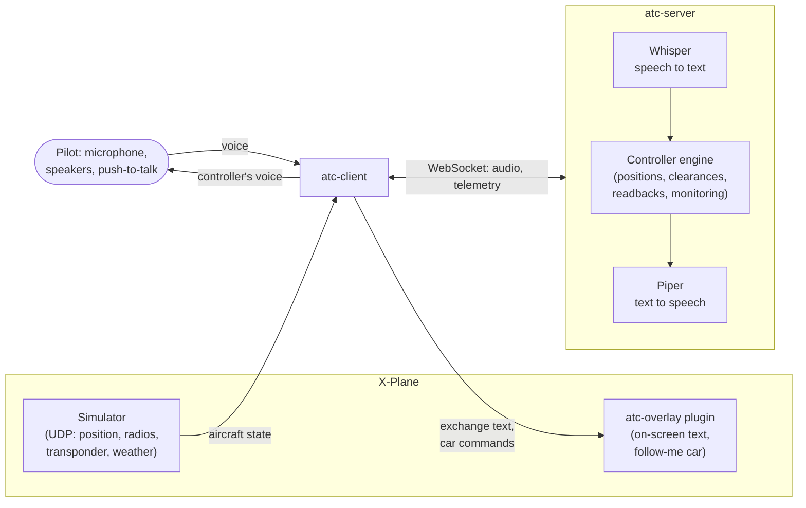

# Virtual ATC

> [!WARNING]
> **This code is written with the help of AI.** The author designs the features and tests the
> working functionality himself, in the simulator, by flying with it. Automated tests cover the
> controller logic, but the voice, radio and X-Plane parts are checked by a human only in the
> setups listed below. Expect rough edges.

A voice air traffic controller for X-Plane that runs entirely on your own computer.

## Why

To practise flying with a controller when you cannot, or do not want to, use a real one in the
simulator (VATSIM, IVAO or similar). You talk on the radio as you would with a real controller,
using standard ICAO phraseology. The controller answers by voice, issues clearances, checks
your readbacks and watches what the aircraft actually does.

What it covers today, at the supported airport:

- ATIS, Delivery, Ground, Tower and Approach, plus hand-offs to the adjacent units (radar,
  flight information, neighbouring towers);
- VFR circuits, VFR entry and exit via the published reporting points;
- IFR departures (SID) and arrivals (STAR, ILS, VOR and RNAV approaches, radar vectors), with
  procedures read from your X-Plane navigation data;
- readback checks, squawk codes, runway in use from the simulator's wind, follow-me car;
- English and Polish radio exchange.

No network service is used at run time: speech recognition, speech synthesis and the
controller all run locally. The internet is needed only to download the speech models once.

### Tested with

| | |
|---|---|
| Simulator | X-Plane 11 (11.10 or later for the follow-me car) |
| Operating system | Linux (Arch Linux, x86-64) |

Windows and macOS are not tested. Release builds are made for Linux (x86-64) and macOS (Apple
Silicon, Whisper on Metal), but the speech-model scripts, the Piper binary and the X-Plane plugin
are Linux-only for now.

## How it works



- **`atc-server`** — the controller: speech recognition, the ATC engine, speech synthesis.
- **`atc-client`** — push-to-talk, microphone and speakers; reads the aircraft state from
  X-Plane over UDP (no X-Plane settings needed).
- **`atc-overlay`** (optional X-Plane plugin) — shows the exchange on screen and draws the
  follow-me car.
- **`atc-replay`** — replays a recorded flight against a scripted exchange (for tests and bug
  reports).

## Speech recognition and synthesis

| Role | Software | Models |
|---|---|---|
| Speech to text | [whisper.cpp](https://github.com/ggerganov/whisper.cpp) through `whisper-rs`, Vulkan GPU backend | `ggml-large-v3-turbo-q5_0` (multilingual, default) or `ggml-small.en-q5_1` (English only, lighter) |
| Text to speech | [Piper](https://github.com/rhasspy/piper) 2023.11.14-2 (runs on the CPU) | English and Polish `medium` voices from [rhasspy/piper-voices](https://huggingface.co/rhasspy/piper-voices), a different voice per position |

The models are downloaded by the scripts in `tools/` into `models/` and are never part of the
repository. **Check the voice licences before use:** every Piper voice used here is derived from
the `lessac` voice, whose dataset is licensed for research use only. Details:
[tools/MODELS.md](tools/MODELS.md), [NOTICE.md](NOTICE.md).

## Prerequisites

- **X-Plane 11**, with its default navigation data (`Resources/default data/CIFP`) for IFR.
- **Rust** (stable, 1.85 or later; the workspace uses edition 2024) — install with
  [rustup](https://rustup.rs).
- A **GPU with Vulkan** for Whisper; about 1 GB of video memory for the default model.
- Build tools and libraries:

| Needed for | What | Arch Linux | Debian / Ubuntu |
|---|---|---|---|
| Whisper (Vulkan build) | CMake, libclang, Vulkan headers and loader, `glslc` | `cmake clang vulkan-headers vulkan-icd-loader shaderc` | `cmake libclang-dev libvulkan-dev glslc` |
| Audio | ALSA headers | `alsa-lib` | `libasound2-dev` |
| Joystick push-to-talk | libudev, read access to `/dev/input/*` (usually the `input` group) | `systemd-libs` | `libudev-dev` |
| Model download | `curl`, `tar` | `curl tar` | `curl tar` |

## Installation

```bash
git clone https://github.com/estatic/ratc.git
cd ratc

# speech models (idempotent; about 750 MB for Whisper, plus Piper and its voices)
tools/fetch-whisper.sh
tools/fetch-piper.sh

# server and client (release matters: Whisper is much slower in a debug build)
cargo build --release -p atc-server -p atc-client
```

### X-Plane plugin (optional, recommended)

```bash
tools/install-xplane-plugin.sh                       # Steam's default X-Plane 11 path
tools/install-xplane-plugin.sh "/path/to/X-Plane 11" # any other install
```

It builds the plugin and installs it as `Resources/plugins/atc-overlay/64/lin.xpl`. Restart
X-Plane afterwards. The window can be moved and resized; bind the command
`atc/overlay/toggle` to a key or button to show or hide it. Reinstall the plugin after
updating the project.

## Configuration

Run everything **from the repository root**: paths in `config/*.toml` are relative to it.

**`config/server.toml`**

| Key | Meaning |
|---|---|
| `xplane_root` | your X-Plane 11 directory. The airport layout (runways, taxiways, stands) is taken from the scenery X-Plane actually loads, and SID/STAR/approaches from its CIFP. Set it, otherwise taxi routes may name taxiways you don't see and IFR is unavailable. |
| `airport` | ICAO code of the airport whose stations run; its data lives in `data/airports/<ICAO>/` |
| `[whisper] model` | the Whisper model file (see above) |
| `[whisper] language` | `"en"`, `"pl"`, or remove the line to answer each aircraft in the language it last spoke |
| `strictness` | `"standard"` or `"training"` (training asks for fewer readback items) |
| `listen` | server address, `127.0.0.1:8740` by default |

**`config/client.toml`**

| Key | Meaning |
|---|---|
| `callsign`, `aircraft_type` | your aircraft, e.g. `"SP-ABC"`, `"C172"` |
| `xplane` | X-Plane's UDP address, `127.0.0.1:49000` by default |
| `field_elev_ft` | elevation of that airport in feet |
| `input_device`, `output_device` | part of the audio device name; system default when omitted |
| `[ptt] key` | keyboard push-to-talk, a **toggle**: press to start, press again to stop (a terminal cannot see key releases) |
| `[ptt] joystick_button` | joystick hold-to-talk button (0 is the trigger); run the client with `RUST_LOG=debug` to see button numbers |

**`config/voices.toml`** — which Piper voice speaks for which position, and the speech rate.

## Running

1. Start X-Plane and park the aircraft on a stand at the airport set in `config/server.toml`.
2. Start the server and wait for `listening on 127.0.0.1:8740`:
   ```bash
   target/release/atc-server            # --fresh: don't restore the flights saved on exit
   ```
3. Start the client in another terminal:
   ```bash
   target/release/atc-client            # voice
   target/release/atc-client --text     # type your transmissions instead (no microphone)
   ```
4. Tune the radio. The station you talk to is the frequency of the radio selected for
   transmission on X-Plane's audio panel (COM1 or COM2); you hear every radio selected for
   listening. Tune the ATIS frequency of the airport, then call Delivery or Ground.

Step-by-step flights (in Russian for now): [VFR circuit](docs/user-guide/ru/scenario-circuit.md),
[IFR departure](docs/user-guide/ru/scenario-ifr-departure.md),
[IFR and VFR points](docs/user-guide/ru/ifr-and-vfr-points.md),
[Polish circuit](docs/user-guide/ru/polish-circuit.md). Phraseology the controller understands:
[English](docs/phraseology/en.md), [Polish](docs/phraseology/pl.md). More detail on every
option: [docs/RUNNING.md](docs/RUNNING.md).

### Common problems

| Symptom | Cause |
|---|---|
| the server exits with code 2 | a model is missing: run `tools/fetch-whisper.sh` / `tools/fetch-piper.sh` |
| `no telemetry from X-Plane yet` | X-Plane is not running, `xplane` in `config/client.toml` is wrong, or a firewall blocks UDP 49000 |
| cannot read `config/...` or `data/airports/...` | not started from the repository root |
| Ground names taxiways that are not in the simulator | `xplane_root` not set, or X-Plane not restarted after installing scenery; see `airport layout:` in the server log |
| "IFR not available, VFR only" | `xplane_root` not set or no CIFP file for the airport |

## Contributing

Contributions are welcome through **pull requests**. Before opening one:

```bash
cargo fmt --all
cargo clippy --workspace --all-targets -- -D warnings
cargo test --workspace
```

The same checks run on every pull request (GitHub Actions, `.github/workflows/ci.yml`).
Keep code, comments and documentation in English (user guides may be in other languages under
`docs/user-guide/<lang>/`). Never commit X-Plane navigation data or speech models. By
contributing you agree to the terms in [CONTRIBUTING.md](CONTRIBUTING.md).

### Reporting a problem

A controller bug can rarely be fixed from a description alone. Please open an issue with the
**Bug report** template, which asks for:

1. **What happened and what you expected** — in plain words.
2. **The radio exchange** — the lines printed by `atc-client` (what the controller said and what
   it understood from you), copied as text, from a few lines before the problem to after it.
3. **The server log** of the same session, for example:
   ```bash
   RUST_LOG=info target/release/atc-server 2>&1 | tee server.log
   ```
   It contains what Whisper heard (`pilot transcript`) and the timings.
4. **Airport and position** — ICAO code, the station you were talking to (Ground, Tower, …) and
   the frequency; the runway in use and the ATIS letter if you know them.
5. **Language** — the `[whisper] language` setting and the language you spoke.
6. **Flight** — VFR or IFR, the clearance you had (destination, SID/STAR, approach), the phase
   of flight, the aircraft type.
7. **Setup** — project version (`git rev-parse --short HEAD`), operating system, X-Plane
   version, the Whisper model, `strictness`, and any changes to `config/*.toml`.
8. **If you can, the recorded track** — run the client with `--record track.csv` and attach the
   file. A track plus the exchange lets the problem be replayed with `atc-replay`
   ([how](docs/RUNNING.md)).

Please remove anything private from logs before posting them.

## Licence

[PolyForm Noncommercial License 1.0.0](LICENSE.md): free for any noncommercial use. Material
from other sources keeps its own licence, see [NOTICE.md](NOTICE.md).
